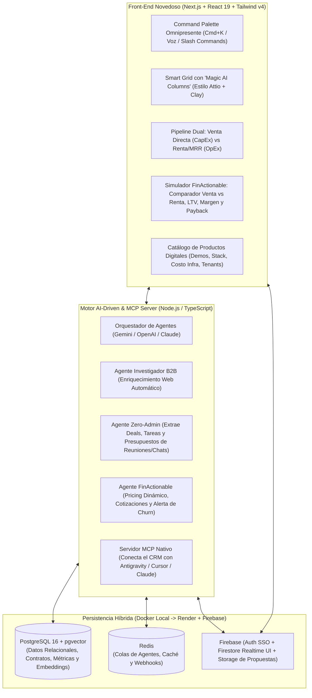

# Investigación Profunda: CRMs de Clase Mundial y Propuesta de Arquitectura Propia para `projectsfactory.io` & `finanactionable.co`

> [!IMPORTANT]
> **Objetivo Estratégico**: Diseñar un **CRM AI-Driven de última generación** adaptado al modelo de negocio dual de **`projectsfactory.io`** (desarrollo y comercialización de productos digitales y Agentes como Servicio - AaaS) y **`finanactionable.co`** (inteligencia financiera accionable, rentabilidad, MRR/ARR y unit economics), operando localmente sobre **Docker Desktop** y desplegable de forma nativa en **Render** y **Firebase**.

---

## 1. Investigación Profunda del Sector de CRMs de Clase Mundial (2026)

El mercado global de CRMs ha vivido una ruptura estructural. Los sistemas tradicionales (*Legacy Systems of Record* como Salesforce clásico o HubSpot tradicional) fueron diseñados como **formularios sobre bases de datos relacionales rígidas** donde los vendedores pierden entre el 30% y el 50% de su tiempo introduciendo datos manualmente.

Hoy, los **CRMs de clase mundial** se dividen en **4 grandes arquetipos arquitectónicos** que definen el nuevo estándar de la industria:

### A. El Nuevo Estándar: CRMs AI-Native y de Objetos Dinámicos ("Systems of Action")
1. **Attio (El estándar de oro en arquitectura de datos flexible y UX moderna)**
   - **Innovación clave**: Sustituye las tablas rígidas de "Contactos/Oportunidades" por un **modelo de objetos y atributos dinámicos** (como bloques de Notion/Airtable pero con escala SQL transaccional).
   - **Frontend**: Interfaz hiper-rápida inspirada en **Linear** (navegación por teclado, `Cmd+K`, vistas de tabla virtualizadas a 60fps, pipelines Kanban y grafos de relaciones).
   - **IA**: *Universal Context* + workflows agénticos que investigan cuentas, clasifican leads y ejecutan acciones al cambiar un atributo.
2. **Day.ai y Clarify CRM (Cero entrada manual / "Ambient & Zero-Admin CRMs")**
   - **Innovación clave**: Invierten el flujo tradicional (*Capture-First, Structure-Later*). En lugar de pedirle al humano que llene campos, **agentes en segundo plano escuchan correos, reuniones, llamadas y chats**, construyendo un grafo de memoria del cliente y actualizando el pipeline automáticamente.
   - **Frontend**: Basado en un feed de actividad inteligente, resúmenes ejecutivos automáticos y dashboards generados por prompts conversacionales.
3. **Folk CRM (Relaciones multi-canal y ligereza operativa)**
   - **Innovación clave**: Captura con un clic desde LinkedIn/X/Gmail mediante extensión (`folkX`), *Magic Fields* (columnas cuya fórmula es un prompt de IA que enriquece o redacta mensajes por fila) y soporte nativo para **MCP (Model Context Protocol)**.

### B. El Motor de Enriquecimiento Programable (GTM Data Orchestration)
4. **Clay (La tabla programable con Agentes de Investigación Web)**
   - **Innovación clave**: Aunque no es un CRM tradicional de cierre, Clay redefinió la prospección con **Waterfall Enrichment** (consulta en cascada a múltiples fuentes de datos) y **Claygent** (un agente IA que visita la web del prospecto, lee su modelo de negocio, precios o noticias y extrae variables estructuradas por fila).

### C. Open-Source & Developer-First (Soberanía de Datos y Extensibilidad)
5. **Twenty CRM (El líder Open-Source alternativo a Attio)**
   - **Innovación clave**: Construido en **TypeScript, React, NestJS, PostgreSQL y Redis**, empaquetado oficialmente en **Docker Compose**. Permite crear objetos personalizados que generan esquemas GraphQL/REST en tiempo de ejecución e incluye un **servidor MCP nativo**.
6. **Huly y Atomic CRM**
   - **Huly**: Plataforma todo-en-uno open-source (CRM + Linear + Slack + Docs) con sincronización en tiempo real.
   - **Atomic CRM**: Kit ligero para desarrolladores React/Supabase enfocado en simplicidad extrema y personalización rápida.

### D. Gigantes Enterprise con Capas Agénticas
7. **Salesforce Agentforce & HubSpot Breeze**
   - **Innovación clave**: Han añadido motores de razonamiento (*Atlas Engine* en Salesforce y *Breeze Agents* en HubSpot) sobre sus nubes de datos empresariales.
   - **Limitación para equipos ágiles**: Costos muy elevados por licencia/crédito, fricción de configuración y arquitecturas monolíticas difíciles de adaptar al modelo de **venta + renta/licenciamiento de activos digitales**.

---

## 2. Tabla Comparativa de CRMs de Clase Mundial

| Plataforma | Categoría | Modelo de Datos | Nivel AI-Driven | UX / Frontend | Persistencia Backend | Soporte MCP / Agentes | Docker Local / Self-Host | Fit para `projectsfactory.io` + `finanactionable.co` |
| :--- | :--- | :--- | :--- | :--- | :--- | :--- | :--- | :--- |
| **Attio** | AI-Native Object CRM | Objetos dinámicos + escala SQL | **Alto**: Workflows con agentes IA y enriquecimiento automático | **10/10**: Estilo Linear, `Cmd+K`, tablas ultra-rápidas | Cloud propietario (PostgreSQL / grafo relacional) | API REST/Webhooks + integraciones IA | No (Solo Cloud SaaS) | **Alto en UX**, pero cerrado y costoso al escalar asientos/datos propios |
| **Twenty CRM** | Open-Source Modern CRM | Objetos dinámicos con GraphQL autogenerado | **Medio-Alto**: Servidor MCP nativo + workflows extensibles | **9/10**: Clon moderno de Attio/Notion en React | **PostgreSQL + Redis** (100% controlado) | **Nativo (MCP Server incluido)** | **Sí (Oficial en Docker Compose)** | **Excelente base técnica**, requiere agregar capa financiera y agentes propios |
| **Day.ai** | Zero-Admin / Conversational | Grafo de memoria conversacional | **Muy Alto**: Captura pasiva total de reuniones/emails | **9/10**: UI conversacional + artefactos dinámicos | Cloud propietario (Grafo + Vector DB) | Interno (Control plane propio) | No (Cloud SaaS) | Excelente inspiración para **Zero-Admin**, pero sin control del código |
| **Clarify CRM** | Autonomous Sales CRM | Pipeline autogenerado por eventos | **Muy Alto**: Auto-creación de deals y campos desde correo/citas | **8.5/10**: Limpio, minimalista, enfocado en llamadas/correo | Cloud propietario | Agente interno (*Clarify Rep*) | No (Cloud SaaS) | Ideal para inspirar el **autopiloto de reuniones**, limitado en contratos de renta |
| **Folk CRM** | Relationship & Magic Fields | Tablas tipo Airtable/Notion | **Alto**: *Magic Fields* (prompts por columna) y enriquecimiento | **9/10**: Muy intuitivo, extensión Chrome `folkX` | Cloud propietario | **Sí (Soporte MCP)** | No (Cloud SaaS) | Gran referencia para **columnas con IA (*Magic Columns*)** |
| **Clay** | GTM Enrichment Engine | Tabla reactiva multi-proveedor | **Muy Alto**: *Claygent* (agente scraper/investigador web) | **8.5/10**: Hoja de cálculo programable de alta densidad | Cloud propietario | vía API / Webhooks | No (Cloud SaaS) | Imprescindible imitar su concepto de **Agente Investigador por fila** |
| **Huly** | Open-Source All-in-One | Documentos + Issues + Contactos | **Medio**: Asistentes de texto y transcripción | **9/10**: Velocidad extrema estilo Linear | CockroachDB / Postgres + Elastic + MinIO | API / Extensible | **Sí (Docker Compose pesado)** | Excelente para unir **CRM + Fábrica de Proyectos**, pero pesado de operar |
| **Atomic CRM** | Open-Source Starter Kit | Relacional clásico (Contactos, Deals, Notas) | **Bajo-Medio**: Requiere integrar tus propios LLMs | **7.5/10**: Práctico y limpio (React) | PostgreSQL / Supabase | Configurable | **Sí (Docker)** | Muy fácil de modificar, pero básico en UI avanzada |
| **HubSpot Breeze** | Suite GTM + IA | Objetos CRM estándar + Custom Objects | **Alto**: *Breeze Prospecting & Content Agents* | **7.5/10**: Completo pero recargado de menús | Cloud propietario | vía API / Breeze Studio | No (Cloud SaaS) | Demasiado rígido y caro para gestionar inventario de productos en venta/renta |
| **Salesforce Agentforce** | Enterprise Agentic CRM | Data Cloud + Objetos empresariales | **Alto**: *Atlas Reasoning Engine* | **6/10**: Complejo, lento sin consultoría dedicada | Cloud propietario | Mulesoft / Agentforce API | No (Cloud SaaS) | Sobredimensionado e impráctico para un equipo ágil de productos digitales |

---

## 3. ¿Por qué `projectsfactory.io` y `finanactionable.co` necesitan su Propia Versión?

Los CRMs convencionales están pensados para vender **un solo producto repetitivo** (ej. una suscripción SaaS única o horas de consultoría). Sin embargo, el modelo de ustedes tiene **tres particularidades únicas** que ningún CRM comercial resuelve de fábrica:

1. **Catálogo Vivo de Activos Digitales (Venta vs. Renta/Licencia)**:
   - Ustedes crean **productos digitales completos, micro-SaaS, plataformas financieras y agentes IA**.
   - Un mismo producto digital en su catálogo puede comercializarse en tres modalidades:
     - **Venta Directa (Buyout / Turnkey IP Transfer)**: Pago único o por hitos + entrega de código/infraestructura.
     - **Renta / Suscripción (White-Label SaaS / Licensing)**: Setup fee + canon mensual recurrente (MRR) por uso, mantenimiento e infraestructura.
     - **Renta por Consumo / Agentes como Servicio (AaaS)**: Cobro base + variable por ejecución/tokens/usuarios.
2. **Inteligencia Financiera Accionable en el Punto de Venta (`FinActionable Inside`)**:
   - En cada negociación, el equipo necesita responder al instante: *«¿Nos conviene más venderle este producto en $15,000 USD o rentárselo en $650 USD/mes durante 24 meses considerando el costo en Render/Firebase y soporte?»*.
   - Integrar el ADN de **`finanactionable.co`** dentro del CRM transforma cada oportunidad en un **simulador vivo de Unit Economics (CAC, LTV, Payback Period, Margen Bruto por Tenant y Flujo de Caja Proyectado)**.
3. **Activos Reutilizables (El CRM como Producto Propio para Venta o Renta)**:
   - Al construir su propio CRM AI-Driven con arquitectura multi-tenant limpia, **el propio CRM se convierte en un nuevo producto estrella del portafolio de `projectsfactory.io`** que pueden vender o rentar en marca blanca a sus propios clientes B2B.

---

## 4. Recomendación: **"NexusPF CRM"** (Nuestra Propia Versión AI-Driven)

Recomendamos construir una plataforma propia combinando **lo mejor de 4 mundos**:
- La **UX ultrarrápida y modelo de objetos flexibles de Attio/Linear**.
- Las **Magic Columns de enriquecimiento agéntico de Clay/Folk**.
- El **Zero-Admin de captura automática de Day.ai/Clarify**.
- El **Motor de Simulación Financiera y MRR/ROI de `finanactionable.co`**.

> [!TIP]
> **¿Cómo aprovechar REA (`Reverse Engineer Anything`) en este desarrollo?**
> Puedes usar las herramientas de REA que ya tienes instaladas (`inspect_web_page`, `analyze_web_bundle`, `inspect_web_network_capture`, `analyze_javascript_application`) para analizar cómo aplicaciones de referencia (como Twenty CRM en local o demos web de Attio/Folk) estructuran sus atajos de teclado `Cmd+K`, su virtualización de celdas a 60fps o sus esquemas JSON-RPC/GraphQL, y pedirle al agente que implemente una versión *clean-room* adaptada a tu stack.

### 4.1. Arquitectura Funcional y Módulos Diferenciadores

### 4.2. Innovaciones del Front-End (Novedoso y Muy Práctico)

1. **Barra de Comando Agéntica (`Ctrl+K` / `Cmd+K`) y Modo "Cero Formularios"**:
   - Nunca obligues al equipo a llenar 20 campos. Pueden pegar un texto libre, un audio de WhatsApp o una transcripción de Google Meet:
     > *"Hablé con Carlos de Grupo Delta, les interesa rentar el sistema de facturación IA por $800/mes con un setup de $2,000, quieren demo el jueves"*
   - El agente extrae automáticamente: **Empresa** (`Grupo Delta`), **Contacto** (`Carlos`), **Producto del Catálogo** (`Sistema de Facturación IA`), **Modalidad** (`Renta / MRR`), **Valor** (`$2,000 Setup + $800 MRR`), **Etapa** (`Demo Agendada`) y crea la tarea para el jueves.
2. **Magic AI Columns (Estilo Clay + Folk)**:
   - En la vista de tabla de prospectos o clientes, puedes crear una columna cuyo tipo sea **`AI Prompt / Agent`**.
   - Ejemplo: Creas la columna *"Producto Digital Recomendado"* y el agente visita el sitio web de cada empresa en la tabla, analiza su sector y sugiere qué producto de `projectsfactory.io` ofrecerle (en venta o renta) y redacta el mensaje personalizado de contacto.
3. **Widget Embebido `FinActionable Pricing & Deal Studio`**:
   - Dentro de cada Deal, un panel interactivo muestra dos curvas financieras lado a lado:
     - **Escenario A (Venta Llave en Mano)**: Ingreso inmediato, margen neto tras horas de ingeniería, cobro opcional de póliza de mantenimiento.
     - **Escenario B (Renta / Suscripción Mensual)**: Punto de equilibrio (*break-even* en meses), MRR acumulado a 12/24/36 meses, costo mensual de infraestructura en Render/Firebase y TIR del contrato.
   - Con un clic genera el **link de propuesta interactiva** donde el propio cliente puede deslizar entre comprar o rentar el software.
4. **Inventario de Productos y Control de Tenants (Product-to-Client Matrix)**:
   - A diferencia de un CRM normal, tienes una vista de **Productos Digitales**: ves qué clientes tienen rentado cada producto, qué versión tienen desplegada, cuál es su estado de pago mensual (activo, por vencer, en mora) y qué módulos adicionales (*upsells*) se les pueden activar con un clic.

---

## 5. Arquitectura de Persistencia y Despliegue: Docker Desktop $\rightarrow$ Render & Firebase

Dado que ya cuentas con **Docker Desktop** en local y planeas publicar en **Render** o **Firebase**, la arquitectura ideal separa claramente el **entorno de desarrollo local reproducible** del **despliegue cloud elástico**:

### 5.1. Stack Tecnológico Recomendado

| Capa | Tecnología | Por qué es la mejor elección para tu equipo |
| :--- | :--- | :--- |
| **Frontend Web** | **Next.js 15 (App Router) + React 19 + TypeScript + Tailwind CSS v4 + shadcn/ui + TanStack Table** | Permite tablas virtualizadas de alto rendimiento (estilo Attio), componentes accesibles, Command Palette (`cmdk`) y despliegue directo en **Firebase App Hosting** o **Render**. |
| **Backend API & Agentes** | **Node.js 22 + TypeScript (Hono o Fastify) + Drizzle ORM / Prisma + Vercel AI SDK / Gemini API** | Ultraligero, tipado de extremo a extremo (RPC/OpenAPI), fácil de exponer como **Servidor MCP** y corre idéntico en un contenedor Docker local o en Render. |
| **Base de Datos Principal** | **PostgreSQL 16 + extensión `pgvector`** | La base de datos relacional más sólida para finanzas (`FinActionable`), contratos, esquemas dinámicos (`JSONB`) y búsqueda vectorial semántica (`pgvector`) en una sola instancia. |
| **Tiempo Real, Auth y Archivos** | **Firebase (Firebase Auth + Firestore/Realtime Events + Cloud Storage)** | Resuelve autenticación (Google/Microsoft SSO), presencia en vivo del equipo en el tablero Kanban y almacenamiento de contratos/PDFs sin sobrecargar tu backend. |
| **Colas y Tareas en Background** | **Redis + BullMQ** (o pg-boss sobre PostgreSQL para ahorrar costos en Render) | Ejecuta agentes de investigación web, envíos de secuencias y sincronización de correos en segundo plano. |

### 5.2. Flujo de Trabajo: De Docker Desktop Local a Producción

1. **En Local (`Docker Desktop`)**:
   - Un único archivo `docker-compose.yml` levanta:
     - `postgres` (`pgvector/pgvector:pg16`) con volumen persistente local.
     - `redis` (`redis:7-alpine`) para colas de agentes.
     - `api` (Backend Node.js/TS con hot-reload).
     - `web` (Frontend Next.js con hot-reload).
2. **En Producción (`Render` + `Firebase`)**:
   - **Frontend**: Desplegado en **Firebase Hosting / App Hosting** (CDN global, SSL automático, integrado con **Firebase Auth**).
   - **Backend + Base de Datos**: Desplegado en **Render** mediante un Blueprint `render.yaml` conectado a tu repositorio GitHub, usando **Render Managed PostgreSQL** (que soporta `pgvector`) y un **Web Service Dockerizado** para el API y los Agentes IA.
   - *(Truco de optimización de costos en Render)*: Si usas **`pg-boss`** (colas sobre el mismo PostgreSQL) en lugar de Redis separado, solo pagas **1 Web Service + 1 PostgreSQL en Render** mientras **Firebase** cubre Auth, Hosting y Realtime en su capa gratuita/económica.

---

## 6. Dos Caminos de Implementación para Empezar Hoy

| Camino | Descripción | Ventajas | Tiempo estimado |
| :--- | :--- | :--- | :--- |
| **Opción 1 (Recomendada): Construir "NexusPF CRM" a medida desde una plantilla limpia Full-Stack en Docker** | Crear en tu entorno un monorepo limpio (`Next.js + Hono/Fastify + Drizzle + PostgreSQL/pgvector + Firebase Auth`) diseñado desde el día 1 con los objetos de **Venta/Renta de Productos Digitales** y el **Simulador FinActionable**. | 100% ligero, sin código basura, fácil de publicar en Render + Firebase y **100% propiedad intelectual de `projectsfactory.io`** (licencia MIT/privada para que puedan venderlo o rentarlo a clientes). | **MVP funcional en 1 a 2 sesiones de trabajo** |
| **Opción 2: Desplegar `Twenty CRM` en Docker y extenderlo** | Levantar el contenedor oficial de `Twenty CRM` en Docker Desktop y conectarle agentes vía su servidor MCP. | Tienes un CRM generalista completo en minutos. | **Rápido para uso interno**, pero su licencia **AGPL-3.0** limita que lo vendas como producto cerrado y su código es más complejo de modificar para finanzas. |
